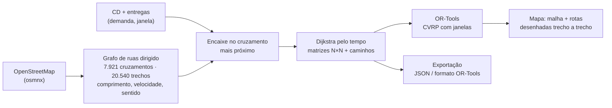

# Delivery Graph Builder: da malha de ruas ao grafo de entregas

O Delivery Graph Builder transforma a **malha viária real de uma cidade em grafo**: os cruzamentos viram nós e os trechos de rua viram arestas, com comprimento, velocidade e sentido. **Só depois** os pontos de entrega entram nesse grafo. Cada entrega é encaixada no cruzamento mais próximo, e as arestas entre as entregas são os menores caminhos **pelas ruas**. Sobre esse grafo, você testa soluções de roteamento (OR-Tools, CVRP com janelas de horário) e vê tudo no mapa.


**▶ Demo online:** https://delivery-graph-builder-canoas.streamlit.app/

## Por que

Modelos de roteamento clássicos, de ML ou quânticos precisam de instâncias realistas. Coordenadas com distância em linha reta ignoram rios, rodovias, mão única e conversões. Partindo da malha de ruas, o grafo de entregas herda tudo isso, e as rotas desenhadas são as que um veículo de fato percorreria. É gratuito (OpenStreetMap) e funciona para qualquer cidade.

Ele nasceu no Instituto Eldorado, na frente de QAOA multiobjetivo para roteamento ([arXiv:2610.00168](https://arxiv.org/abs/2610.00168)). Lá, as instâncias começavam em Canoas/RS com 5, 10, 15 e 20 nós e escalavam para outras cidades. O exemplo usa um CD no polo logístico Velopark (Nova Santa Rita/RS) e entregas fictícias em Canoas.

## Como funciona



| Camada | O que é |
|---|---|
| **1. Grafo de ruas** | `routing/streetgraph.py` baixa a malha "drive" do OSM, mantém o maior componente fortemente conexo (todo cruzamento alcança qualquer outro respeitando o sentido), estima velocidade por tipo de via e grava um JSON compacto de 0,6 MB. O app não precisa de internet nem do osmnx |
| **2. Grafo de entregas** | As entregas são encaixadas nos cruzamentos. As matrizes de tempo e distância saem dos menores caminhos pelo grafo de ruas, e a mão única faz ida e volta diferirem |
| **3. Rotas** | OR-Tools com capacidade, janelas de horário e jornada do CD. Quando a frota não comporta, o solver descarta entregas com penalidade e diz quais, em vez de falhar |
| **Painel** | Malha colorida pela velocidade da via, arestas entre entregas seguindo as ruas, rotas por veículo, tabela de paradas com horário de chegada e heatmap da matriz. Dá para sortear outro cenário e mudar o número de entregas, a frota e a capacidade |

## Rodar

```bash
pip install -r requirements.txt
streamlit run app.py                                   # painel de Canoas
pytest                                                 # malha, encaixe, caminhos, solver, exportação e app

# outra cidade: baixar a malha e gerar um cenário (requer: pip install osmnx)
python -m routing.streetgraph --bbox -23.60 -23.54 -46.72 -46.62 --out data/sp_streets.json.gz
python -m routing.scenario --streets data/sp_streets.json.gz --n 15 \
  --depot -23.5679 -46.6852 --bbox -23.59 -23.55 -46.70 -46.64 --ortools data/sp_15_ortools.json
```

As velocidades são as nominais de cada tipo de via, sem trânsito. Para pesos que variam com o horário, veja o projeto irmão abaixo.

## Projetos relacionados

- [route-time-crawler](https://github.com/marcosreballo-source/route-time-crawler): coleta contínua de tempos de trajeto por horário, para pesos que **variam com o trânsito**.
- [quantum-routing-research](https://github.com/marcosreballo-source/quantum-routing-research): QGAT e QAOA multiobjetivo, que consomem grafos como estes.
