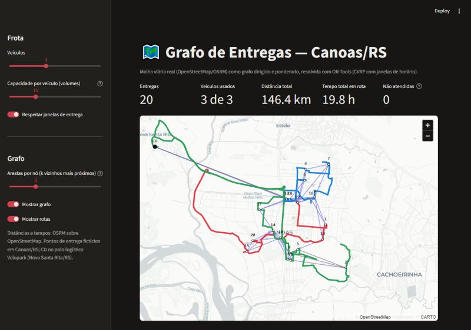

# Delivery Graph Builder: grafos de entrega sobre a malha viária real

O Delivery Graph Builder recebe um **centro de distribuição e um conjunto de pontos de entrega** e devolve o **grafo dirigido e ponderado da malha viária real** entre eles: distância e tempo por OpenStreetMap/OSRM. Com o grafo pronto, você **testa soluções de roteamento** (OR-Tools, CVRP com janelas de horário) e vê tudo **sobre o mapa**.



**▶ Demo online:** https://delivery-graph-builder-canoas.streamlit.app/

## Por que

Modelos de roteamento clássicos, de ML ou quânticos precisam de instâncias realistas. Coordenadas com distância euclidiana ignoram rios, rodovias, sentido único e conversões. Este gerador cria instâncias **com pesos reais da rua**, em qualquer cidade, a custo zero (OSRM/OSM), e já no formato que solvers e benchmarks esperam.

Ele nasceu no Instituto Eldorado, na frente de QAOA multiobjetivo para roteamento ([arXiv:2610.00168](https://arxiv.org/abs/2610.00168)). Lá, as instâncias começavam em Canoas/RS com 5, 10, 15 e 20 nós e escalavam para outras cidades. O cenário de exemplo usa um CD no polo logístico Velopark (Nova Santa Rita/RS) e 20 entregas fictícias em Canoas.

## O que faz

| Etapa | Como |
|---|---|
| **Gerar o grafo** | `python -m routing.scenario --n 20 --depot LAT LNG --bbox ...` sorteia os pontos, ajusta cada um à rua mais próxima e busca a matriz completa N×N de tempo e distância no OSRM |
| **Exportar** | JSON do cenário e formato OR-Tools (`--ortools arquivo.json`), com matrizes inteiras em metros e segundos |
| **Resolver** | OR-Tools com capacidade, janelas de horário e jornada do CD. Quando a frota não comporta, o solver descarta entregas com penalidade e diz quais, em vez de falhar |
| **Visualizar** | Painel Streamlit + pydeck com nós (demanda e janela), arestas dos k vizinhos coloridas pelo tempo, rotas desenhadas pelas ruas reais e heatmap da matriz. A assimetria ida × volta mostra que a malha é um grafo dirigido |

## Rodar

```bash
pip install -r requirements.txt
streamlit run app.py                                         # painel com o cenário de Canoas
python -m routing.scenario --n 15 --depot -23.5679 -46.6852 \
  --bbox -23.60 -23.54 -46.72 -46.62 --out data/sp_15.json \
  --ortools data/sp_15_ortools.json                          # outra cidade (São Paulo)
pytest                                                       # solver, exportação, grafo e app
```

## Projetos relacionados

- [route-time-crawler](https://github.com/marcosreballo-source/route-time-crawler): coleta contínua de tempos de trajeto por horário, para pesos que **variam com o trânsito**.
- [quantum-routing-research](https://github.com/marcosreballo-source/quantum-routing-research): QGAT e QAOA multiobjetivo, que consomem grafos como estes.
